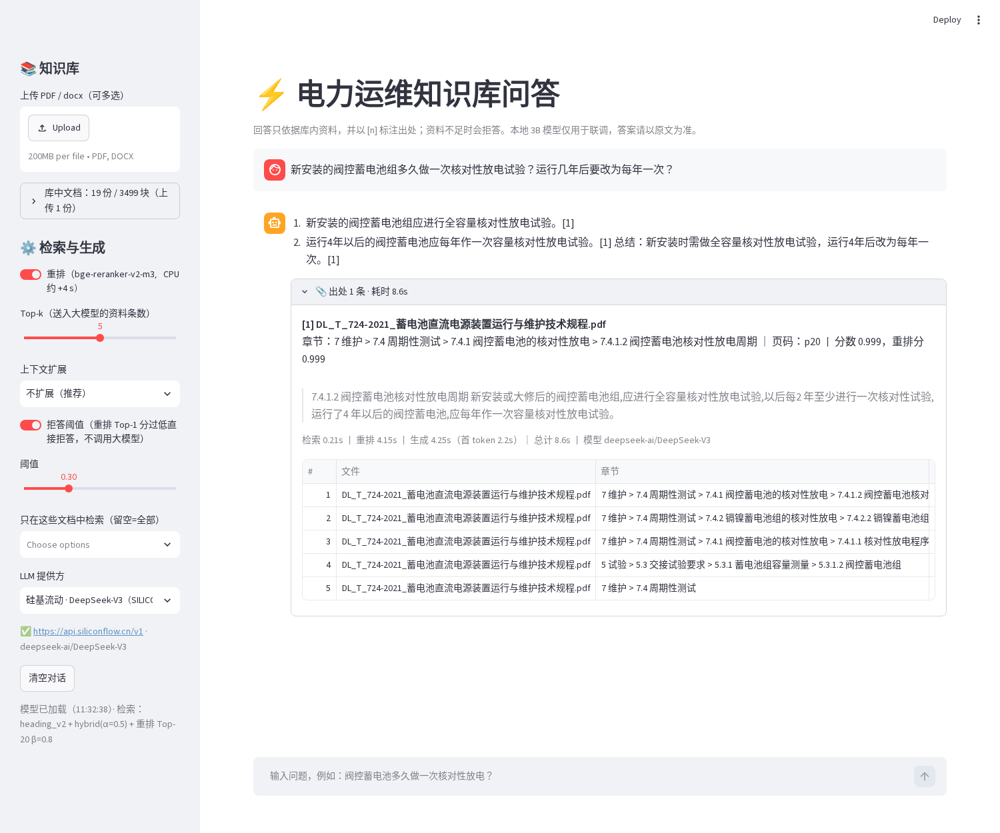
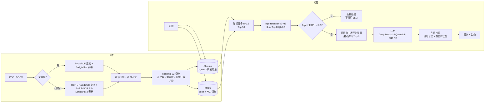
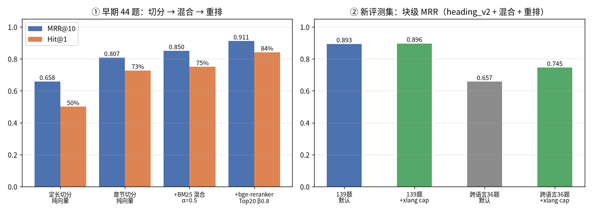
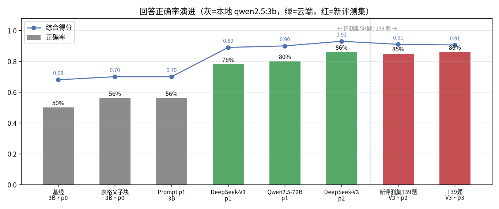

# PowerKB · 电力设备运维知识库 RAG

> 面向变电运维场景：把电力行业标准（DL/T）、厂商说明书、扫描件“读懂”，回答时给出**可点开核对的出处**；资料里没有就拒答。


-lightgrey)

## 核心成果

数字均出自 `output/` 下的评测结果文件，统计口径见[评测方法](#评测方法)。

| 维度 | 结果 | 来源 |
|---|---|---|
| 知识库 | 19 份文档（DL/T 标准、南网文件、ABB/施耐德/西门子/平高/正泰手册，含 1 份扫描件），754 页 → 3499 个检索块，抽出 175 张结构化表格 | `output/tables_stats.md` |
| 检索 | 44 题评测：MRR **0.658 → 0.911**，Hit@1 **50% → 84%**（定长切分纯向量 → 章节切分 + BM25 混合 + 重排） | `output/rerank_results.md` |
| 回答 | 139 题新评测集，DeepSeek-V3：正确 **85%**，综合得分 0.91，引用命中标注块 94% | `output/version_scores.md` |
| 表格题 | 本地 3B 模型、9 道表格题：正确 33% → **56%**（表格父子块切分） | `output/baseline_scores.md` |
| 拒答 | 库外题拒答 **100%**；重排分阈值 0.3 在库内 139 题上误拒 0%，44% 的库外题在调用 LLM 之前就被拦下 | `output/threshold_scan.md` |
| 成本 | 云端跑 144 题评测约 ¥0.68（硅基流动 DeepSeek-V3，按公开价估算） | `output/version_scores.md` |
| 部署 | CPU 可跑；本地 qwen2.5:3b 离线模式 / 云端 OpenAI 兼容接口一键切换；Streamlit 支持上传文档增量入库 | `app.py` |

## 界面截图



左侧：上传 PDF/DOCX 增量入库，调重排、Top-k、上下文扩展、拒答阈值，选 LLM 提供方。右侧：流式回答，带 `[n]` 引用；展开“出处”可看到文件、章节路径、页码、原文片段、检索分和重排分，以及各阶段耗时。

## 系统架构



## 技术栈

| 环节 | 选型 | 说明 |
|---|---|---|
| 解析 | PyMuPDF、python-docx | 文字层 PDF 直接取字和表格（`page.find_tables()`） |
| OCR | RapidOCR（ONNX）、PaddleOCR 3.x PP-StructureV3 | 扫描页自动 OCR；Paddle 放在独立 Python 3.11 环境，作为常驻子进程运行 |
| 切分 | 自研 `chunk.py` / `tables.py` | 识别“1.2.3 / 第X章 / 附录A / 表N”等标题；表格父子块 |
| 向量 | BAAI/bge-m3（sentence-transformers，CPU） | 归一化后用 cosine，带向量缓存 |
| 向量库 | Chroma（本地持久化） | metadata：source / 章节路径 / page / chunk_type / table_id |
| 关键词 | rank_bm25 + jieba | 自定义电力词典，数值和单位不拆开（`dict/`） |
| 重排 | BAAI/bge-reranker-v2-m3（CrossEncoder） | 一阶段 Top-20 重排，最终分 = 0.8·重排分 + 0.2·一阶段分 |
| LLM | OpenAI 兼容接口：硅基流动、DeepSeek、OpenAI、xAI、本地 Ollama | 环境变量配置；429/5xx 自动退避重试 |
| 界面 | Streamlit | 流式输出、出处展开、增量入库、按哈希去重 |
| 评测 | 自研 `evaluate.py` | 检索 Hit@k/MRR、要点覆盖自动评分、引用、拒答、耗时；支持缓存续跑和并发 |

## 快速开始

### 1. 环境

```bash
cd power_kb
python3.13 -m venv .venv && source .venv/bin/activate
pip install torch --index-url https://download.pytorch.org/whl/cpu   # CPU 版，避免下载 CUDA
pip install -r requirements.txt
# 可选：Streamlit 自测截图
python -m playwright install chromium
```

- 首次运行会自动下载 bge-m3（约 2.2 GB）和 bge-reranker-v2-m3（约 2.2 GB），可设置 `HF_HOME` 指定缓存目录。
- PaddleOCR 是可选项，需要单独的 Python 3.11 环境（安装命令见 `requirements.txt` 末尾）。没装时扫描页自动改用 RapidOCR，可用 `OCR_ENGINE=rapid|paddle` 强制指定。

### 2. 准备文档并重建索引

本仓库**不含**任何标准原文或 PDF。按 [`docs/sources.md`](docs/sources.md)（即 power_kb_sources.md） 列出的公开地址自行下载，放到 `/workspace/power_docs/`（其它路径用 `--docs-root` 指定）。

```bash
python build_v2.py --docs-root /workspace/power_docs     # 解析 + OCR + 表格 + heading_v2 切分 → output/chunks_heading_v2.jsonl
python embed_index.py --methods heading_v2                # bge-m3 向量 → chroma_db/（增量；--rebuild 全量重建）
python bm25_index.py  --methods heading_v2                # BM25 → bm25_index/
```

`build_v2.py` 可用 `--max-size 800 --overlap 50` 调切分长度（默认就是这组值），`--name` 指定集合名，`--ocr-engine` 指定 OCR 引擎。

### 3. 配置 LLM（任选其一）

```bash
cp .env.example .env    # 只是变量清单；程序读取的是进程环境变量，需要 export 或 set -a; source .env
```

| 提供方 | 需要的环境变量 | 说明 |
|---|---|---|
| 硅基流动（推荐） | `SILICONFLOW_API_KEY`，可选 `SILICONFLOW_MODEL` | 默认 `deepseek-ai/DeepSeek-V3`，备选 `Qwen/Qwen2.5-72B-Instruct` |
| DeepSeek 官方 | `DEEPSEEK_API_KEY` | `--provider deepseek` |
| 本地 Ollama | 无 | 先 `sh deploy/start_ollama.sh`（端口 11434），再 `ollama pull qwen2.5:3b-instruct`（或用 `deploy/Modelfile.qwen2.5-3b` 从 GGUF 创建同名模型） |
| 任意兼容接口 | `LLM_BASE_URL`、`LLM_MODEL`、`LLM_API_KEY` | 不传 `--provider` 时生效 |

其它可选变量：`RAG_PROMPT`（p0/p1/p2，默认本地 p1、云端 p2）、`RAG_EXPAND`（默认 none）、`RAG_REFUSE_BELOW`（默认 0.3，填 off 关闭）、`LLM_TIMEOUT`（默认 180 秒）。

### 4. 启动 Web 界面

```bash
sh deploy/start_app.sh      # 后台运行 streamlit run app.py --server.port 8501，日志写到 /workspace/streamlit.log
# 或在前台运行：streamlit run app.py
```

浏览器打开 `http://localhost:8501`。侧栏选择 LLM 提供方；可以上传新的 PDF/DOCX，入库后立即可检索。

### 5. 命令行问答 / 检索

```bash
python rag.py --provider siliconflow --stream "运行中SF6设备灭弧气室的湿度限值是多少？"
python rag.py --provider siliconflow --model Qwen/Qwen2.5-72B-Instruct --expand parent --refuse-below off "问题"
python rag.py "问题"                         # 不传 provider：用 LLM_BASE_URL，未设置时用本地 Ollama
python retrieve.py "阀控蓄电池核对性放电周期" -k 5      # 只看检索结果（默认集合 heading_v2、hybrid + 重排）
python retrieve.py "SF6 湿度" --mode bm25 --no-rerank --source DL_T_595-2025_六氟化硫电气设备气体监督导则.pdf
```

### 6. 跑评测

```bash
python validate_eval_set_v3.py                                  # 校验评测集：evidence 必须能在原切块中找到
python evaluate.py --input eval_set_v3.jsonl --collection heading_v2 --retrieval-only --tag retr   # 只评检索，不需要 LLM
python evaluate.py --input eval_set_v3.jsonl --collection heading_v2 --provider siliconflow \
       --prompt p2 --rules 3 --workers 4 --tag v3set              # 完整评测；有缓存，中断后可续跑
python version_scores.py                                        # 汇总 → output/version_scores.md / .xlsx
python evaluate.py --input eval_xling.jsonl --collection heading_v2 --retrieval-only --xlang llm --tag xl   # 可选：跨语言改写
python evaluate.py --rescore output/eval_runs/<run> --rules 3   # 重算分数 + Context Recall/忠实度/归因，不调 LLM
python -m pytest tests/test_numcheck.py -q                      # 数值校验回归测试
```

每次运行输出到 `output/eval_runs/<tag>_<时间>/`（`per_item.jsonl`、`summary.json`、`report.md`），摘要追加到 `output/baseline_scores.md`。
注意：`evaluate.py` 的 `--collection` 默认是 `heading`、`--prompt` 默认是 `p0`，这是为了能复现历史结果，评当前推荐配置时要显式传参（见上）。

## 目录结构

```text
power_kb/
├── parse.py / ocr.py / tables.py      # 解析、OCR（rapid|paddle）、表格抽取与跨页合并
├── paddle/paddle_worker.py            # PaddleOCR 常驻子进程（独立 Python 3.11 环境）
├── chunk.py / build_v2.py / run.py    # 切分（fixed / heading / recursive / heading_v2）
├── embed_index.py / bm25_index.py     # Chroma 向量索引、BM25 索引（增量 + 重建）
├── retrieve.py / rerank.py            # 混合检索、融合、重排、表格行→整表展开
├── context_expand.py                  # 上下文扩展 none|neighbor|parent（实验用，默认关闭）
├── rag.py                             # Prompt、LLM 调用、引用校验、拒答阈值、CLI
├── kb_store.py / app.py               # 上传增量入库 / 删除；Streamlit 界面
├── evaluate.py / judge_eval.py        # 统一评测入口；LLM 评委对比
├── threshold_scan.py / sf_cost.py     # 拒答阈值扫描；云端 token 与费用统计
├── eval_set_50.* / eval_set_v3.*      # 评测集（jsonl / md / xlsx）
├── eval_ood.jsonl / evalset/          # 库外与边界题、出题与审阅脚本
├── dict/                              # jieba 电力词典
├── deploy/                            # 启动脚本、批量评测脚本、make_zip.py、出图脚本
├── docs/DEVLOG.md                     # 完整开发日志（Day 3–16 的全部技术细节）
├── docs/images/                       # README 用图
└── output/                            # 评测报告、统计、人工核对记录（切块原文不入库，见版权说明）
```

## 效果演进




**检索**（44 题，heading 集合，块级命中；`output/hybrid_results.md`、`output/rerank_results.md`）

| 版本 | Hit@1 | Hit@5 | MRR@10 | 说明 |
|---|---|---|---|---|
| 定长切分 500 字 + 纯向量 | 50.0% | 86.4% | 0.658 | 对照组 |
| 章节切分 + 纯向量 | 72.7% | 90.9% | 0.807 | 块边界与条款对齐 |
| + BM25 加权混合（α=0.5） | 75.0% | 100% | 0.850 | 型号、编号、数值类问题召回更好 |
| + bge-reranker-v2-m3（Top-20，β=0.8） | **84.1%** | **100%** | **0.911** | 当前默认配置 |

**回答**（eval_set_50：库内 50 题 + 库外 5 题，自动评分规则 v2；检索固定为混合 + 重排）

| 版本 | 块MRR | 正确 | 得分 | 引用命中 | 库外拒答 | 误拒 | 秒/题 |
|---|---|---|---|---|---|---|---|
| 基线：heading v1 + qwen2.5:3b + p0 | 0.892 | 50% | 0.68 | 56% | 100% | 2% | 26.1 |
| 表格父子块 heading_v2（核对修复后） | 0.873 | 56% | 0.70 | 60% | 80% | 4% | 28.0 |
| + Prompt p1（逐条作答、步骤编号、数值照抄） | 0.873 | 56% | 0.70 | 66% | 100% | 2% | 18.7 |
| 换云端 DeepSeek-V3 + p1 | 0.873 | 78% | 0.89 | 96% | 100% | 0% | 15.8 |
| 云端 Qwen2.5-72B + p1 | 0.873 | 80% | 0.90 | 92% | 100% | 0% | 13.0 |
| **DeepSeek-V3 + p2（要点先行 + 总结句）** | 0.873 | **86%** | **0.93** | **98%** | 100% | 0% | 11.8 |
| 新评测集 v3（139 + 5 题，规则 v3）DeepSeek-V3 + p2 | 0.893 | 85% | 0.91 | 94% | 100% | 1% | 14.0 |

最后一行换了评测集和评分规则，不能和上面各行直接比较。云端“秒/题”是 4 路并发下的平均值。

## 关键设计与取舍

- **为什么按章节切分**：标准是按条款写的，一个条款就是一个完整的规定。在同样 32 题上，章节切分的 Hit@1 为 0.812，定长切分 0.562，递归切分 0.656（`output/eval_results.md`）。在 v2 管线上调切分长度：max 400 时 MRR 降到 0.813，max 1200 为 0.852，overlap 0 或 150 都不如默认的 800/50（0.873），所以保留默认值。
- **为什么加 BM25**：只看原 32 道语义题时，混合检索略差于纯向量（MRR 0.854 vs 0.881）。加入 12 道关键词型题（型号、表号、数值）后，44 题整体 MRR 从 0.807 提高到 0.850，Hit@5 达到 100%。实际运维提问里有大量这类问法，所以保留 BM25，并在融合后用重排把语义题的排序补回来。
- **表格父子块**：表格单独抽成 Markdown 父块，每行再生成一句自然语言描述作为子块（例如“表3 断路器灭弧气室 SO2 3～20 μL/L…”）。检索命中子块后，送给 LLM 的是带表头的整表。效果：9 道表格题的正确率从 33% 提高到 56%；全集正确率 50% → 56%，代价是块 MRR 从 0.892 降到 0.873（行级子块会挤占排名）。人工核对 20 张表：修复后 9 张完全正确、5 张有小错、2 张严重错误，4 张误识别为表格的已被过滤（`output/table_audit.md`）。前后对比见 `output/table_before_after.md`。
- **为什么默认不开上下文扩展**：用 DeepSeek-V3 + p2 实测，不扩展 86%，neighbor 84%，parent 84%，差异在噪声范围内，而输入 token 分别多 42% 和 57%。逐题检查发现，漏掉的要点其实已经在 Top-5 上下文里，问题出在生成阶段，不在召回。
- **拒答阈值主要用来省调用**：DeepSeek-V3 本身就能拒掉全部 22 道库外题，本地 3B 能拒掉 21/22。阈值 0.3 是保守取值（库内最低的 Top-1 分为 0.395），作用是让 44% 的库外题不必调用 LLM，节省时间和费用，并不是拒答能力的主要来源。阈值拦不住“看起来相关”的边界题，例如 N22 的重排分达到 0.561。
- **OCR 双引擎**：在正泰 NM1 扫描件上，RapidOCR 的正文字符错误率（CER）为 0.18%，PaddleOCR 为 0.53%，RapidOCR 也更快（0.92 vs 5.24 s/页）。但只有 PaddleOCR 能还原表格结构，所以默认用 PaddleOCR（检测到 Paddle 环境时），代价是子进程峰值内存约 4.5 GB（`output/ocr_compare.md`）。
- **Prompt 按模型分档**：p2 在 3B 上得分最高（0.73），但慢 2.3 倍，库外拒答还从 100% 降到 80%，所以本地默认用 p1；在 V3 上 p2 没有这些副作用，云端默认用 p2。

- **本地提准实验（Day 17，不调云端）**：归因拆分显示 V3 新基线未答对的 15% 中，检索失败 5%、生成漏写 10%（Context Recall 95%），瓶颈在生成。据此做的检索侧改进都没有在全集上胜出：跨语言改写在 36 道跨语言题上 MRR 0.657→0.716（3B 翻译 0.726），但在 139 题上让中文题 Hit@1 85.0%→76.1%；Contextual 前缀中性（MRR 0.893→0.890）；规则多查询退步（0.852）。因此检索默认不变，只把数值校验 v2 设为默认。详见 `docs/DEVLOG.md` Day 17。


## 评测方法

- **评测集**
  - `eval_set_50`：50 道库内题（查参数 18 / 故障排查 16 / 操作步骤 16，英文 8 题）+ 5 道拒答题，全部人工编写。
  - `eval_set_v3`：139 道库内题（55 / 41 / 43，英文 19%，跨条款综合题 7 道，覆盖 19 份文档）+ 5 道拒答题。其中 89 道新题由 **DeepSeek-V3 根据切块起草，再经人工审阅**（第一轮 73 道草稿删掉 15 道）。
  - `eval_ood.jsonl`：22 道库外题和边界题，每道都经过检索核查，确认库内确实答不了。
  - 每道题都标注了来源文件、章节、页码，以及 `evidence` 原文片段。`validate_eval_set_v3.py` 会检查 evidence 是否是对应切块原文的子串。
- **检索指标**：块级和文档级的 Hit@1/3/5、MRR，按题型和语言分组统计。
- **回答指标**
  - 自动评分：把 key_points 逐条与回答比对（数值做单位归一化后精确匹配，其余做关键词匹配），给出“正确 / 部分 / 错误”三档。规则 v3 把要点分为 core 和 minor，core 覆盖率 ≥ 0.75 判为正确，得分 = 0.8·core + 0.2·minor。
  - 引用：引用编号是否合法、引用的资料里是否包含标注的依据块。
  - 拒答：库外题的拒答率、库内题的误拒率。
  - 耗时：检索、重排、生成分别计时。
- **自动评分与人工判断的一致率**
  - 规则 v2，30 题：总体 77%，但其中用来调规则的 18 题是 94%，调完规则后另抽的 12 题只有 50%（`docs/DEVLOG.md`）。
  - 规则 v3：在没参与定规则的新题上抽查 27 题。自动判“正确”的 8/8 一致；判“部分/错误”的 19 题中 9 题一致，另有 8 题人工判得更高（规则偏严）。按分布加权估计一致率约 89%（`output/manual_labels_v3.jsonl`）。
  - 用 DeepSeek-V3 做 LLM 评委，与人工的一致率只有 67%，低于自动规则的 77%，所以没有采用（`output/judge_eval.md`）。
- **口径说明**：库内只有 50 或 139 题，在 50 题集上 1 题就是 2 个百分点，正确率相差 8 个百分点以内基本在噪声范围内。新题由 V3 起草，可能偏向 V3 擅长的问法。切分和检索的结论只对这 19 份文档成立。

## 已知局限与后续计划

**局限**
- 自动评分偏严：数值带条件括注、“M4×45”这类写法、单位类要点容易误判为“部分”。正确率在 80% 以上时，最好结合人工抽查来看。
- 数值引用校验 v2（`numcheck.py`）在 258 例人工标注回归集上误报率 3.3%（v1 为 100%），但漏报率 8.7%：表头声明单位时篡改值若以裸数值出现在同块别处会被放过。
- 表格抽取：无框线的三线表（ABB VD4）和扫描件复杂表头（NM1 第 5 页）仍有严重错误；跨页续表和多行表头的归属偶尔不准。
- 剩下的错误主要是**漏要点**（多条件、附加注意事项），不是数值写错；本地 3B 模型只适合联调。
- 全部在 CPU 上运行：重排约 4 s/问，首次加载模型约 1 分钟；PaddleOCR 峰值内存约 4.5 GB。
- 评测集规模小，没有做多次重复运行的方差估计。

- 跨语言检索、Contextual 前缀、多查询、reflect 自检均已实现为可选开关，但本地验证未在 139 题全集上超过基线，默认关闭（见下方“本地提准实验”）。

**后续计划**
- 生成端：p3（要点清单先行）在本地 3B 难题子集上得分 0.455→0.545，需用云端模型在全集上正式验证；reflect 需更强的模型判断缺失点。
- 表格：加入无框线表算法，尝试多模态模型直接读表格截图。
- 评测：扩展到 300 题以上并邀请领域人员复核；做多次运行取置信区间；评分改为规则和 LLM 评委相结合。
- 工程：重排换成 GPU 或 ONNX 量化；Docker 化部署；加权限控制和文档版本管理（标准新旧版本并存的问题）。

## 数据与版权声明

- 本仓库**只包含代码、评测题目和统计结果**，不含任何标准原文、厂商手册 PDF/DOCX，也不包含由它们生成的全文切块（`output/chunks*.jsonl`、`uploads/chunks_uploaded*.jsonl`、`output/parsed/` 等已写入 `.gitignore`）。这些文件可以按[快速开始](#2-准备文档并重建索引)第 2 步在本地重新生成。
- 文档来源和公开下载地址见 [`docs/sources.md`](docs/sources.md)（即 power_kb_sources.md）。标准文本版权归各发布机构所有，手册版权归各厂商所有。
- 评测集的 `evidence` 字段和截图中只有少量原文片段，用于学习研究和效果核对；如有不妥请联系删除。
- 代码以 [MIT License](LICENSE) 开源，许可**只适用于代码**。

---

完整开发过程（每天的设计、实验、踩坑）见 [docs/DEVLOG.md](docs/DEVLOG.md)。
