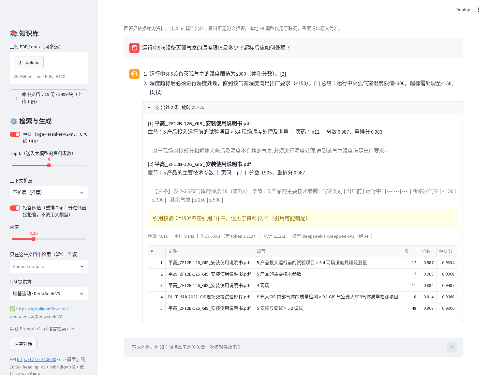
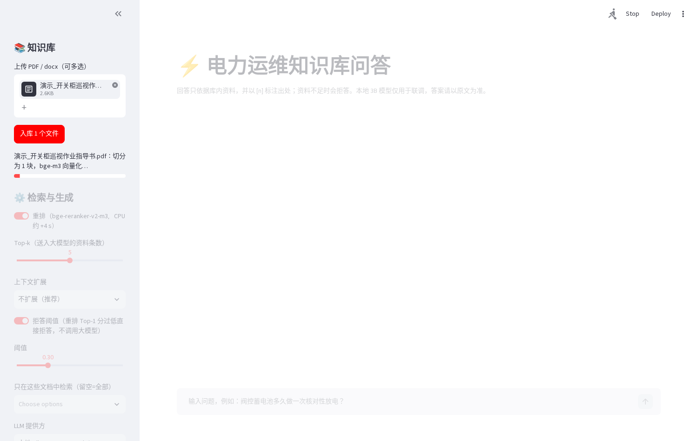
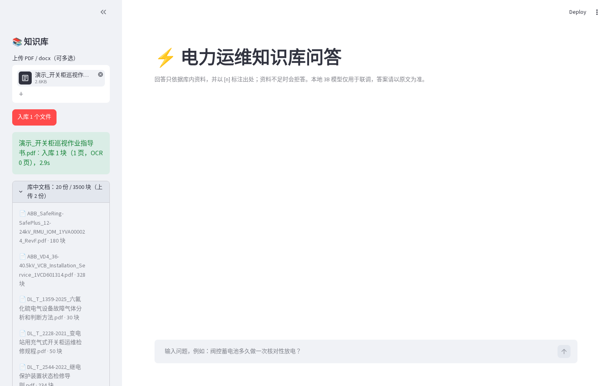
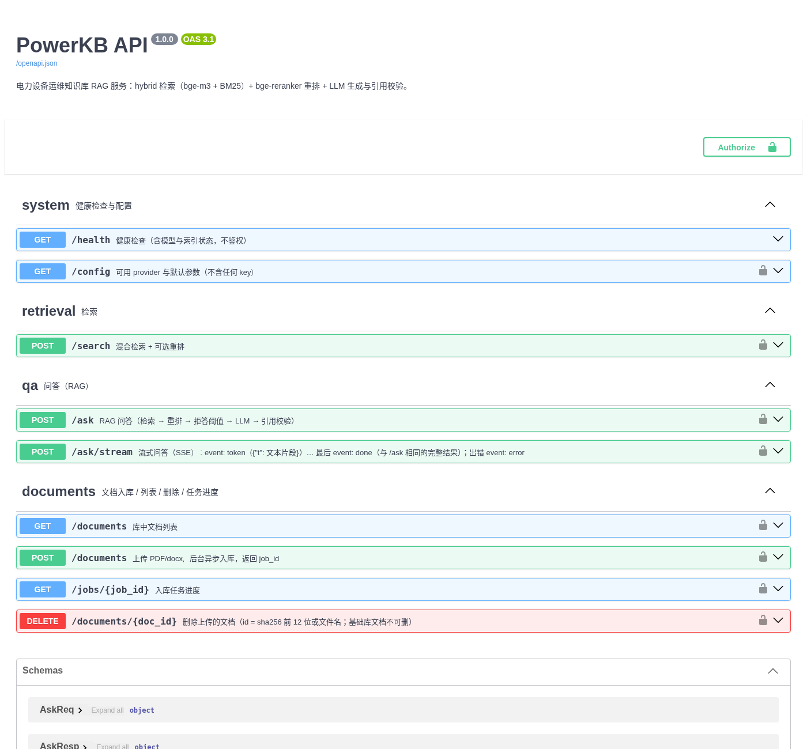
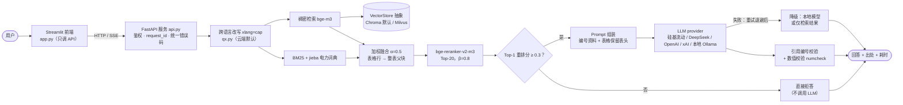
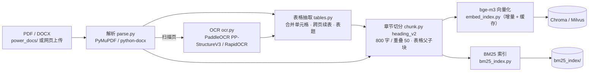
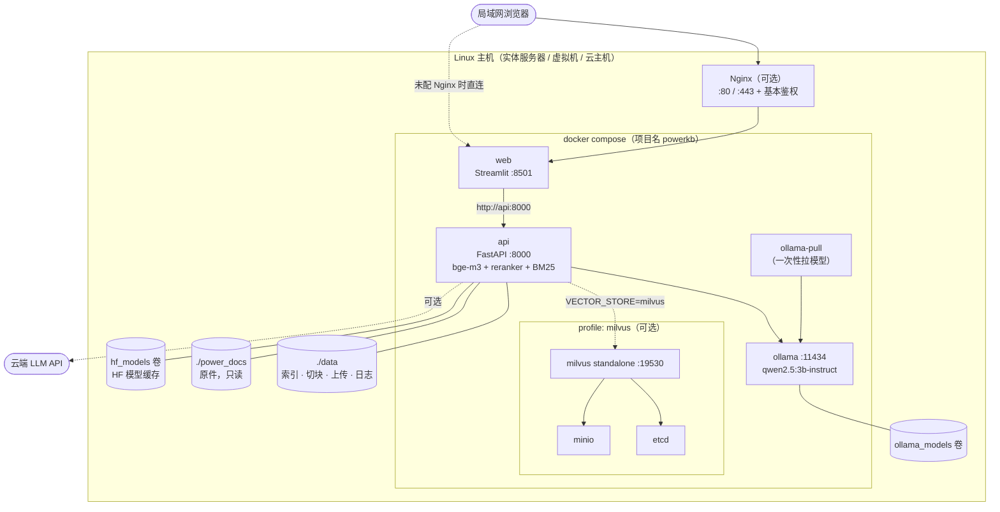
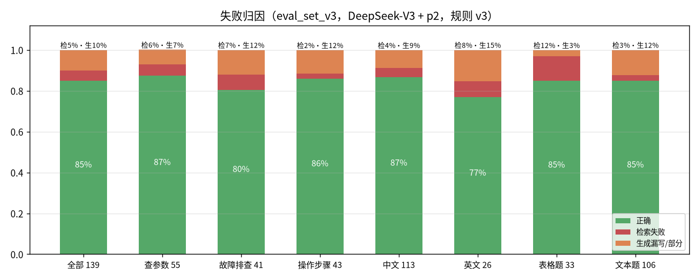

# PowerKB · 电力设备运维知识库 RAG

> 面向变电运维：把电力行业标准（DL/T）、厂商说明书、扫描件“读懂”，回答时给出**可点开核对的出处**；资料里没有就拒答。全部可在 CPU 上运行，本地模型 / 云端模型一键切换。


-lightgrey)

技术细节与实验过程见 [docs/DEVLOG.md](docs/DEVLOG.md)，部署手册见 [docs/DEPLOY.md](docs/DEPLOY.md)。

## 核心成果

数字均出自 `output/` 下的结果文件，口径见[评测方法](#评测方法)。

| 维度 | 结果 | 来源 |
|---|---|---|
| 知识库 | 19 份文档（DL/T 标准、南网文件、ABB/施耐德/西门子/平高/正泰手册，含 1 份扫描件），754 页 → 3499 个检索块，抽出 175 张结构化表格 | `output/tables_stats.md` |
| 检索 | 44 题：MRR **0.658 → 0.911**、Hit@1 **50% → 84%**（定长切分纯向量 → 章节切分 + BM25 + 重排）；139 题新评测集 MRR 0.893，跨语言 36 题 MRR 0.657 → **0.745**（`xlang=cap`） | `output/rerank_results.md`、`output/version_scores.md` |
| 回答 | 139 题新评测集，DeepSeek-V3：正确 **85%**、得分 0.91、引用命中标注块 94%、引用编号合法 100% | `output/version_scores.md` |
| 拒答 | 库外题拒答 **100%**；重排分阈值 0.3：库内误拒 0%，44% 的库外题不调用 LLM 直接拦截 | `output/threshold_scan.md` |
| 成本 | 云端跑一轮 144 题评测约 ¥0.68（硅基流动 DeepSeek-V3，按公开价估算） | `output/version_scores.md` |
| 工程 | FastAPI 服务 + Streamlit 纯前端；向量库抽象（Chroma / Milvus 检索结果逐题一致）；集中配置、结构化日志与自动打码、统一错误码、LLM 失败降级；Docker Compose 一键部署；pytest 91 项通过 | `api.py`、`vector_store.py`、`config.py`、`tests/` |

## 效果截图

**问答 + 出处展开**（硅基流动 DeepSeek-V3；回答带 `[n]` 引用，出处给出文件、章节路径、页码、原文片段、检索分 / 重排分、各阶段耗时；黄色条是数值引用校验给出的提示）



<table><tr>
<td width="50%"><b>上传入库进度</b>（异步任务，轮询进度：解析 → 切分 → 向量化 → 索引）<br></td>
<td width="50%"><b>入库完成与文档列表</b>（按哈希去重，上传文档可删除）<br></td>
</tr></table>

**FastAPI 接口文档**（`/docs`，Swagger）



## 系统架构

### 在线问答链路



### 离线入库链路



### Docker 部署拓扑



## 技术栈

| 环节 | 选型 | 说明 |
|---|---|---|
| 解析 / OCR | PyMuPDF、python-docx；RapidOCR、PaddleOCR PP-StructureV3 | 扫描页自动 OCR；Paddle 在独立 Python 3.11 环境中作为常驻子进程 |
| 切分 | 自研 `chunk.py` / `tables.py` | 识别“1.2.3 / 第X章 / 附录A / 表N”等标题；表格父子块 |
| 检索 | bge-m3 + rank_bm25/jieba；`qx.py` 跨语言改写 | 加权融合；数值与单位不拆分（`dict/`） |
| 向量库 | Chroma（默认）/ Milvus Lite / Milvus Standalone | `vector_store.py` 抽象接口，`VECTOR_STORE` 切换，附迁移脚本 |
| 重排 | bge-reranker-v2-m3（CrossEncoder，CPU） | Top-20，最终分 = 0.8·重排 + 0.2·一阶段 |
| LLM | OpenAI 兼容：硅基流动、DeepSeek、OpenAI、xAI、本地 Ollama | 分类重试 + 退避；失败降级到本地或“仅检索结果” |
| 服务 / 前端 | FastAPI + uvicorn；Streamlit + httpx | SSE 流式、异步入库任务、Token 鉴权、CORS、上传校验 |
| 配置 / 日志 / 异常 | pydantic-settings；logging；`errors.py` | 密钥只认环境变量；text/json 日志、轮转、request_id、自动打码；统一错误体 |
| 部署 | Docker Compose（多阶段镜像、非 root、tini、健康检查） | api / web / ollama，`--profile milvus`；首次启动自动建索引 |
| 评测 | 自研 `evaluate.py` | Hit@k / MRR、要点覆盖、引用、拒答、归因、耗时；缓存续跑、并发 |

## 部署（实体服务器 / 任意 Linux 主机）

完整步骤、Nginx + HTTPS、内网 / 离线部署、故障排查见 **[docs/DEPLOY.md](docs/DEPLOY.md)**。下面是最短路径。

**1. 硬件**：x86_64，**8 核 / 16 GB 内存起步**（实测 API 空闲约 1.6 GB、问答时重排有峰值，Ollama 3B 约 2.4 GB，首次建索引更高）；磁盘建议 100 GB（镜像约 2.8 + 5.6 GB、HF 模型约 5–8 GB、Ollama 模型约 2 GB、索引约 1 GB，外加构建缓存）。不需要 GPU。系统推荐 Ubuntu 22.04 / 24.04。

**2. 装 Docker、拉代码、生成 .env**（脚本幂等，可重复运行；默认装到 `/opt/power-kb-rag`）

```bash
git clone https://github.com/lilongkui-feng/power-kb-rag.git && cd power-kb-rag
sudo START=0 APP_DIR=$(pwd) bash deploy/bootstrap.sh       # 装 Docker（国内默认阿里云源）、生成 .env / config.yaml、建 data/ power_docs/
# 海外网络加 CN_MIRROR=0；已装好 Docker 会自动跳过安装
```

**3. 配置**：编辑 `.env`（只放密钥和少量覆盖项，见[配置](#配置)）。只用本地模型时可以什么都不填；开放给局域网多人使用时建议设置 `KB_API_TOKEN`。

**4. 准备数据**：仓库不含原件。把 PDF/DOCX 放进 `power_docs/`（可有子目录），例如 `rsync -avP ./power_docs/ user@<服务器IP>:/opt/power-kb-rag/power_docs/`；来源见 [`docs/sources.md`](docs/sources.md)。首次启动时 api 发现索引为空会自动建索引（8 核约 10–30 分钟）。

**5. 一键启动**

```bash
sh deploy/up.sh                 # = docker compose up -d --build：api + web + ollama（Chroma）
sh deploy/up.sh milvus          # 可选：Milvus Standalone
sh deploy/up.sh --hostnet       # 容器 bridge 网络异常时改用宿主机网络
sh deploy/up.sh down            # 停止（数据保留）
```

**6. 验证**

```bash
docker compose ps                                         # api / web / ollama 均为 (healthy)
curl -s http://127.0.0.1:8000/health                      # "status":"ok"、"models_loaded":true、vector_count == bm25_docs
curl -s -X POST http://127.0.0.1:8000/ask -H 'Content-Type: application/json' \
     -d '{"question":"运行中SF6设备灭弧气室的湿度限值是多少？","provider":"local"}'
```

**7. 局域网访问与防火墙**：浏览器访问 `http://<服务器内网IP>:8501`。启用了 ufw 时放行内网网段：`sudo ufw allow from 192.168.0.0/16 to any port 8501 proto tcp`（网段按实际修改）。注意 **Docker 发布的端口会绕过 ufw**，如需严格限制，设 `KB_BIND=127.0.0.1` 并通过 Nginx 对外（DEPLOY.md §8）。开机自启：compose 中各服务均为 `restart: unless-stopped`，Docker 开机自启后服务自动恢复。

**8. 可选**：Nginx 反向代理 + 基本鉴权 + HTTPS；无外网时用 `docker save/load` 导入镜像、拷贝 HF 缓存和 Ollama 模型（DEPLOY.md「实体服务器 / 内网部署」）。

### 本机开发（不用 Docker）

```bash
python3 -m venv .venv && source .venv/bin/activate
pip install torch --index-url https://download.pytorch.org/whl/cpu && pip install -r requirements.txt
python build_v2.py --docs-root /path/to/power_docs        # 解析 + OCR + 表格 + heading_v2 切分
python embed_index.py --methods heading_v2                 # bge-m3 → Chroma（增量；--rebuild 全量）
python bm25_index.py  --methods heading_v2                 # BM25
sh deploy/start_ollama.sh && ollama pull qwen2.5:3b-instruct   # 可选：本地模型
sh deploy/start_api.sh && sh deploy/start_app.sh           # API :8000 + 前端 :8501（默认只监听本机）
python rag.py --provider siliconflow --stream "运行中SF6设备灭弧气室的湿度限值是多少？"
python retrieve.py "阀控蓄电池核对性放电周期" -k 5
```

## 配置

`config.py`（pydantic-settings）集中管理。优先级：**环境变量 > `.env` > `config.yaml` > 代码默认值**。字段名与环境变量同名（不区分大小写），空值视为未设置；`config.yaml` 可按小节书写（见 [`config.example.yaml`](config.example.yaml)）。`python config.py` 打印脱敏后的生效配置，`python config.py get <key>` 读取单项。

**密钥只能放环境变量或 `.env`**（`SecretStr`，日志与摘要中只显示“已设置/未设置”）；`config.yaml` 中出现 `*api_key / *token / secret / password` 类键会直接报 `ConfigError` 拒绝启动。

| 变量 | 默认 | 说明 |
|---|---|---|
| `SILICONFLOW_API_KEY` / `DEEPSEEK_API_KEY` / `OPENAI_API_KEY` / `XAI_API_KEY` | — | 云端 provider 的 key（只放 .env / 环境变量） |
| `KB_API_TOKEN` | — | 非空即开启 API 鉴权（`Authorization: Bearer` 或 `X-API-Key`），前端用同一值 |
| `SILICONFLOW_MODEL` / `LOCAL_LLM_MODEL` / `LOCAL_LLM_URL` | `deepseek-ai/DeepSeek-V3` / `qwen2.5:3b-instruct` / `http://127.0.0.1:11434/v1` | 模型名与本地地址 |
| `LLM_FALLBACK` | `retrieval` | LLM 失败时：`retrieval` 仅检索结果 / `local` 改用本地 / `local_then_retrieval` / `none` 报错 |
| `LLM_TIMEOUT` / `LLM_MAX_RETRIES` / `LLM_TIMEOUT_RETRIES` | 180 / 5 / 1 | 读超时（秒）；429·5xx·网络错误重试次数；超时重试次数 |
| `RAG_PROMPT` / `RAG_XLANG` | 空 | 空 = 本地 p1 + 不改写；云端 p2 + `cap` |
| `RAG_REFUSE_BELOW` / `RAG_EXPAND` | `0.3` / `none` | 拒答阈值（`off` 关闭）；上下文扩展 |
| `RERANK_TOP_N` / `RERANK_BETA` / `HYBRID_ALPHA` / `TOP_K` | 20 / 0.8 / 0.5 / 5 | 检索与重排参数 |
| `VECTOR_STORE` / `MILVUS_URI` | `chroma` / `milvus_db/power_kb.db` | 向量库与 Milvus 地址（Lite 文件或 `http://host:19530`） |
| `HF_HOME` / `HF_ENDPOINT` | — | 模型缓存目录；国内可设 `https://hf-mirror.com` |
| `LOG_LEVEL` / `LOG_FORMAT` / `LOG_DIR` / `LOG_QUESTIONS` | `INFO` / `text` / `logs` / `false` | 日志级别、`text｜json`、目录（容器内 `data/logs`）、是否记录问句原文 |
| `KB_MAX_UPLOAD_MB` / `KB_MAX_CONCURRENCY` / `KB_CORS_ORIGINS` | 50 / 2 / 本机 8501 | 上传上限、并发检索问答数、CORS |
| `KB_API_PORT` / `KB_WEB_PORT` / `KB_BIND` | 8000 / 8501 / `0.0.0.0` | Docker 端口与绑定地址 |
| `PIP_MIRROR` / `TORCH_INDEX_URL` | 空 / PyTorch CPU 源 | 构建镜像时的 pip / torch 源 |

完整列表见 `config.example.yaml` 与 `.env.example`。

## API 接口

Swagger：`http://<host>:8000/docs`。所有错误统一为 `{"error": {"code", "message", "detail", "request_id"}}`，响应头带 `X-Request-ID`。

| 方法 | 路径 | 说明 |
|---|---|---|
| GET | `/health` | 状态、模型是否加载、向量数 / BM25 块数、文档数（不鉴权） |
| GET | `/config` | provider 可用性（不返回 key）、默认参数、检索配置、上传限制 |
| POST | `/search` | `query, top_k, rerank, sources, filters, xlang` → 命中块 + 一阶段分 + 重排分 + 元数据 |
| POST | `/ask` | `question, provider, model, prompt, top_k, rerank, expand, refuse_below, sources, xlang` → `answer, citations, warnings, retrieved, timing, usage, degraded, fallback` |
| POST | `/ask/stream` | 同 `/ask`，SSE：`start` → `token`… → `done`；出错为 `error` 事件 |
| POST | `/documents` | 上传 PDF/DOCX → 202 + `job_id`（后台串行入库） |
| GET | `/jobs/{job_id}` | `queued / running / done / duplicate / failed`、进度、失败原因 |
| GET / DELETE | `/documents`、`/documents/{id}` | 文档列表；删除上传文档（基础库 403） |

```bash
curl -s localhost:8000/search -H 'Content-Type: application/json' -d '{"query":"运行中SF6设备灭弧气室湿度限值","top_k":3}'
curl -s localhost:8000/ask -H 'Content-Type: application/json' -d '{"question":"阀控蓄电池多久做一次核对性放电？","provider":"local"}'
curl -N localhost:8000/ask/stream -H 'Content-Type: application/json' -d '{"question":"SafeRing压力表指针在红区时怎么办？","provider":"siliconflow"}'
curl -s -F file=@某手册.pdf localhost:8000/documents && curl -s localhost:8000/jobs/<job_id>
# 开启鉴权后加：-H "Authorization: Bearer $KB_API_TOKEN"
```

主要错误码：400 `provider_not_ready` · 401 `unauthorized` · 404 `not_found` · 413 `payload_too_large` · 415 `unsupported_type` · 422 `validation_error` / `document_parse_error` · 429 `llm_rate_limited` · 502 `llm_auth_failed` / `llm_error` · 503 `llm_unavailable` / `index_not_ready` · 504 `llm_timeout` · 500 `internal_error`（完整表与日志格式见 [DEVLOG](docs/DEVLOG.md)）。

## 评测结果

### 演进总表

| 阶段 | 评测集 | 配置 | 检索（块级） | 回答 | 来源 |
|---|---|---|---|---|---|
| 基线 | 44 题 | 定长 500 字 + 纯向量 | MRR 0.658，Hit@1 50.0% | — | `output/hybrid_results.md` |
| 按章节切分 | 44 题 | heading + 纯向量 | MRR 0.807，Hit@1 72.7% | — | 同上 |
| 混合检索 | 44 题 | + BM25 α=0.5 | MRR 0.850，Hit@5 100% | — | 同上 |
| 重排 | 44 题 | + bge-reranker Top-20 β=0.8 | MRR **0.911**，Hit@1 84.1% | — | `output/rerank_results.md` |
| 回答基线 | 50+5 题 | heading v1 + qwen2.5:3b + p0 | MRR 0.892 | 正确 50%，得分 0.68，库外拒答 100% | `output/version_scores.md` |
| 表格父子块 | 50+5 题 | heading_v2（核对修复后）+ 3B + p0 | MRR 0.873 | 正确 56%，得分 0.70（表格 9 题 33%→56%） | 同上 |
| Prompt | 50+5 题 | + p1（逐条作答、步骤编号） | MRR 0.873 | 正确 56%，引用命中 66%，18.7 s/题 | 同上 |
| 换云端 V3 | 50+5 题 | DeepSeek-V3 + p1 / p2 | MRR 0.873 | p1：78%、0.89；**p2：86%、0.93**、引用命中 98% | 同上 |
| 新评测集 | 139+5 题 | V3 + p2，规则 v3 | MRR 0.893，Hit@5 97.1% | 正确 **85%**，得分 0.91，误拒 1% | 同上 |
| 跨语言 cap | 139 题 / 跨语言 36 题 | + `xlang=cap`（云端默认） | 139 题 MRR 0.896；36 题 0.657→**0.745**，Hit@5 75.0%→86.1% | —（检索评测） | `output/version_scores.md`、`output/xling_retrieval.md` |

换评测集或评分规则的行之间不能直接比较；云端秒/题为 4 路并发均值。


### 最新基线（eval_set_v3，DeepSeek-V3 + p2，规则 v3）

| 分组 | 题数 | 块 Hit@1 | 块 Hit@5 | 块 MRR | 文档 Hit@1 | 正确 | 部分 | 错误 | 得分 | 引用命中块 | 误拒 |
|---|---|---|---|---|---|---|---|---|---|---|---|
| 全部 | 139 | 83.5% | 97.1% | 0.893 | 98.6% | 84.9% | 12.2% | 2.9% | 0.910 | 93.5% | 0.7% |
| 查参数 | 55 | 80.0% | 96.4% | 0.873 | 98.2% | 87.3% | 12.7% | 0% | 0.936 | 94.5% | 0% |
| 故障排查 | 41 | 85.4% | 97.6% | 0.915 | 97.6% | 80.5% | 9.8% | 9.8% | 0.854 | 90.2% | 2.4% |
| 操作步骤 | 43 | 86.0% | 97.7% | 0.899 | 100% | 86.0% | 14.0% | 0% | 0.930 | 95.3% | 0% |
| 中文 | 113 | 85.0% | 98.2% | 0.904 | 98.2% | 86.7% | 10.6% | 2.7% | 0.920 | 94.7% | 0% |
| 英文 | 26 | 76.9% | 92.3% | 0.845 | 100% | 76.9% | 19.2% | 3.8% | 0.865 | 88.5% | 3.8% |

库外 5 题拒答 100%；平均耗时 13.95 s/题（检索 4.24、重排 3.97、生成 6.97，4 路并发）。来源：`output/eval_runs/v3set_sf_v3_p2_attr_20261011-120349/summary.json`。

### 失败归因

| 分组 | 题数 | 正确 | 检索失败 | 生成漏写 | Context Recall |
|---|---|---|---|---|---|
| 全部 | 139 | 84.9% | 5.0% | 10.1% | 94.6% |
| 查参数 / 故障排查 / 操作步骤 | 55 / 41 / 43 | 87.3% / 80.5% / 86.0% | 5.5% / 7.3% / 2.3% | 7.3% / 12.2% / 11.6% | 93.0% / 92.7% / 98.4% |
| 中文 / 英文 | 113 / 26 | 86.7% / 76.9% | 4.4% / 7.7% | 8.8% / 15.4% | 95.3% / 91.3% |
| 表格题 / 文本题 | 33 / 106 | 84.8% / 84.9% | 12.1% / 2.8% | 3.0% / 12.3% | 87.7% / 96.7% |

结论：**瓶颈在生成**（漏写要点占 2/3），表格题则主要是检索失败。Context Recall = core 要点在送入 LLM 的上下文中的覆盖率。



### 向量库：Chroma vs Milvus（139 题，检索评测）

| 后端 | 块 Hit@1 / Hit@5 / MRR | Top-50 检索 p50 / p95 | 内存增量 |
|---|---|---|---|
| Chroma（默认） | 83.5% / 97.1% / 0.893 | 4.5 / 5.6 ms | ≈ 190 MB |
| Milvus Lite | 83.5% / 97.1% / 0.893（逐题名次一致） | 9.3 / 10.0 ms | ≈ 470 MB |
| Milvus Standalone | `/search`、`/ask` 功能验证 | — | 另 3 个容器 |

3.5k 块规模下向量检索不到端到端耗时的 1%（重排约 4 s 才是大头），默认保留 Chroma；需要扩容或多服务共享时迁移（`python migrate_chroma_to_milvus.py --methods heading_v2`）。来源：`output/vs_compare.md`。

### 尝试过但未采用

| 尝试 | 结果 | 结论 |
|---|---|---|
| 切分长度 400 / 1200、重叠 0 / 150 | MRR 0.813 / 0.852 / 0.847 / 0.863，均低于默认 800/50 的 0.873 | 保留 800/50 |
| 上下文扩展 neighbor / parent（V3 + p2） | 正确 84% / 84%（不扩展 86%），输入 token +42% / +57% | 默认关闭 |
| 本地 3B + Prompt p2 | 得分 0.73（最高）但慢 2.3 倍，库外拒答 100%→80% | 本地用 p1，云端用 p2 |
| 跨语言 `xlang=dict`（词典翻译） | 139 题 MRR 0.893→0.841，中文 Hit@1 85.0%→76.1% | 不默认 |
| 跨语言 V3 翻译全量融合 `xlang=llm` | 139 题 MRR 0.875，中文 MRR 0.904→0.878 | 改用 `cap`（译句候选 ≤30%） |
| Contextual 块前缀 | MRR 0.890（中性） | 不默认 |
| 规则多查询 `multiq=rule` | MRR 0.852（退步） | 不默认 |
| V3 + p3（要点清单先行） | 正确 86%、得分 0.906（基线 0.910），人工抽查 15 道变化题净 +5，但新增 1 道误拒 | 不默认 |
| V3 + p3 + reflect（自检补检） | 得分 0.917，耗时 46 s/题，费用约 1.8 倍 | 不默认 |
| DeepSeek-V3 作为 LLM 评委 | 与人工一致率 67%，低于自动规则的 77% | 采用规则评分 + 人工抽查 |

## 关键设计与取舍

- **按章节切分**：标准按条款组织，一个条款就是完整规定。32 题上章节切分 Hit@1 0.812，定长 0.562，递归 0.656（`output/eval_results.md`）。
- **保留 BM25**：只看语义题时混合略差于纯向量（MRR 0.854 vs 0.881），但加入型号 / 表号 / 数值类问题后整体 0.807→0.850、Hit@5 100%；运维提问里这类问法很多，重排再把语义题排序补回来。
- **表格父子块**：表格抽成 Markdown 父块，每行生成一句自然语言子块用于检索，命中后把带表头的整表送给 LLM。表格题 33%→56%，代价是块 MRR 0.892→0.873。人工核对 20 张表：9 张全对、5 张小错、2 张严重错误、4 张误识别已过滤（`output/table_audit.md`）。
- **不做上下文扩展**：漏掉的要点其实已在 Top-5 里，问题在生成而不在召回；扩展只增加 token。
- **拒答阈值主要用来省调用**：V3 本身能拒掉全部 22 道库外题；阈值 0.3 偏保守（库内最低 Top-1 分 0.395），让 44% 的库外题不调用 LLM，但拦不住“看起来相关”的边界题（N22 重排分 0.561）。
- **跨语言用 cap 而不是全量融合**：全量融合会挤掉中文题的正确块；把译句候选限制在重排池的 30% 后，跨语言题明显提升、中文题持平。
- **OCR 双引擎**：正泰 NM1 扫描件上 RapidOCR 正文 CER 0.18%、PaddleOCR 0.53%，但只有 PaddleOCR 能还原表格结构，宿主机默认 Paddle；Docker 镜像只带 RapidOCR（体积与依赖考虑）。
- **失败要可见、可降级**：LLM 失败默认返回“仅检索结果”而不是报错；所有错误带 `request_id`，日志自动打码，便于现场排查。

## 评测方法

- **评测集**：`eval_set_50`（50 题 + 5 拒答，人工编写）；`eval_set_v3`（139 题：查参数 55 / 故障排查 41 / 操作步骤 43，英文 19%，覆盖 19 份文档，+5 拒答；其中 89 道由 DeepSeek-V3 按切块起草后人工审阅，删掉 15 道草稿）；`eval_ood.jsonl`（22 道库外 / 边界题，检索核查确认库内答不了）；`eval_xling.jsonl`（36 道跨语言题）。每题标注来源文件、章节、页码和 `evidence` 原文，`validate_eval_set_v3.py` 校验 evidence 为切块子串。
- **检索指标**：块级 / 文档级 Hit@1/3/5、MRR，按题型和语言分组。
- **回答指标**：key_points 逐条比对（数值单位归一化后精确匹配，其余关键词匹配），规则 v3 区分 core / minor，core 覆盖 ≥0.75 判正确，得分 = 0.8·core + 0.2·minor；引用合法性与命中；库外拒答率、库内误拒率；分阶段耗时；归因（检索失败 / 生成漏写）。
- **自动评分可信度**：规则 v3 在未参与定规则的 27 题上抽查，自动判“正确”8/8 一致，判“部分/错误”的 19 题中 9 题一致、8 题人工判得更高（规则偏严），加权估计一致率约 89%（`output/manual_labels_v3.jsonl`）。
- **口径**：50 题集上 1 题 = 2 个百分点，相差 8 个百分点以内基本是噪声；新题由 V3 起草，可能偏向 V3 擅长的问法；结论只对这 19 份文档成立；未做多次重复运行的方差估计。

```bash
python evaluate.py --input eval_set_v3.jsonl --collection heading_v2 --retrieval-only --tag retr
python evaluate.py --input eval_set_v3.jsonl --collection heading_v2 --provider siliconflow --prompt p2 --rules 3 --workers 4 --tag v3set
python evaluate.py --rescore output/eval_runs/<run> --rules 3          # 只重算分数与归因，不调用 LLM
python version_scores.py                                              # 汇总 → output/version_scores.md / .xlsx
python -m pytest tests -q                                             # 全部测试（test_api 需先启动 API）
```

## 目录结构

```text
power_kb/
├── parse.py / ocr.py / tables.py      # 解析、OCR（rapid|paddle）、表格抽取与跨页合并
├── chunk.py / build_v2.py             # 切分（fixed / heading / recursive / heading_v2）
├── embed_index.py / bm25_index.py     # 向量索引、BM25 索引（增量 + 重建）
├── retrieve.py / rerank.py / qx.py    # 混合检索、融合、重排、跨语言改写
├── rag.py / numcheck.py               # Prompt、LLM 调用与降级、引用与数值校验、CLI
├── api.py / app.py / kb_store.py      # FastAPI 服务；Streamlit 纯前端；上传入库与删除
├── vector_store.py                    # 向量库抽象：ChromaStore / MilvusStore；migrate_chroma_to_milvus.py
├── config.py / errors.py / kblog.py   # 集中配置；异常与错误码；统一日志（request_id、打码、轮转）
├── evaluate.py / version_scores.py    # 评测入口；版本汇总
├── eval_set_50.* / eval_set_v3.* / eval_ood.jsonl / eval_xling.jsonl
├── dict/                              # jieba 电力词典、中英术语表
├── tests/                             # api / errors / config / logging / vector_store / numcheck
├── Dockerfile / docker-compose*.yml / Makefile
├── deploy/                            # bootstrap.sh、up.sh、启动脚本、截图与出图脚本、make_zip.py
├── docs/                              # DEPLOY.md、DEVLOG.md、sources.md、images/
└── output/                            # 评测报告与统计（全文切块不入库）
```

## 已知局限

- 剩余错误以**漏要点**为主（多条件、附加注意事项），不是数值写错；本地 3B 只适合联调。
- 自动评分偏严：带条件括注的数值、“M4×45”类写法易被判“部分”；正确率 80% 以上时应结合人工抽查。
- 数值校验 v2 在 258 例回归集上误报 3.3%、漏报 8.7%（截图中的黄色提示就是这类告警，可能误报）。
- 表格：无框线三线表（ABB VD4）和扫描件复杂表头仍有严重错误；英文问中文标准的 Hit@5 仍偏低。
- 全 CPU：重排约 4 s/问；Docker 镜像只有 RapidOCR，扫描件表格效果不如宿主机 PaddleOCR 环境。
- 评测规模小（139 题、19 份文档），新题由 V3 起草；无多次运行置信区间。
- 部署：默认 bridge 网络模式和 `bootstrap.sh` 的 Docker 安装部分尚未在真实的干净服务器上完整跑过（开发环境只验证了 hostnet 模式和脚本的非 Docker 部分）。

后续：用云端模型正式验证 p3 / reflect；无框线表算法或多模态读表；评测扩到 300 题以上并请领域人员复核；重排换 GPU 或 ONNX 量化；权限与文档版本管理。

## 数据与版权声明

- 本仓库**只包含代码、评测题目和统计结果**，不含任何标准原文、厂商手册 PDF/DOCX，也不含由它们生成的全文切块（`output/chunks*.jsonl`、`uploads/` 等已写入 `.gitignore`），可在本地按上文步骤重新生成。
- 文档来源与公开下载地址见 [`docs/sources.md`](docs/sources.md)。标准文本版权归各发布机构所有，手册版权归各厂商所有。
- 评测集 `evidence` 字段和截图中仅含少量原文片段，用于学习研究与效果核对；如有不妥请联系删除。
- 代码以 [MIT License](LICENSE) 开源，许可**只适用于代码**。
