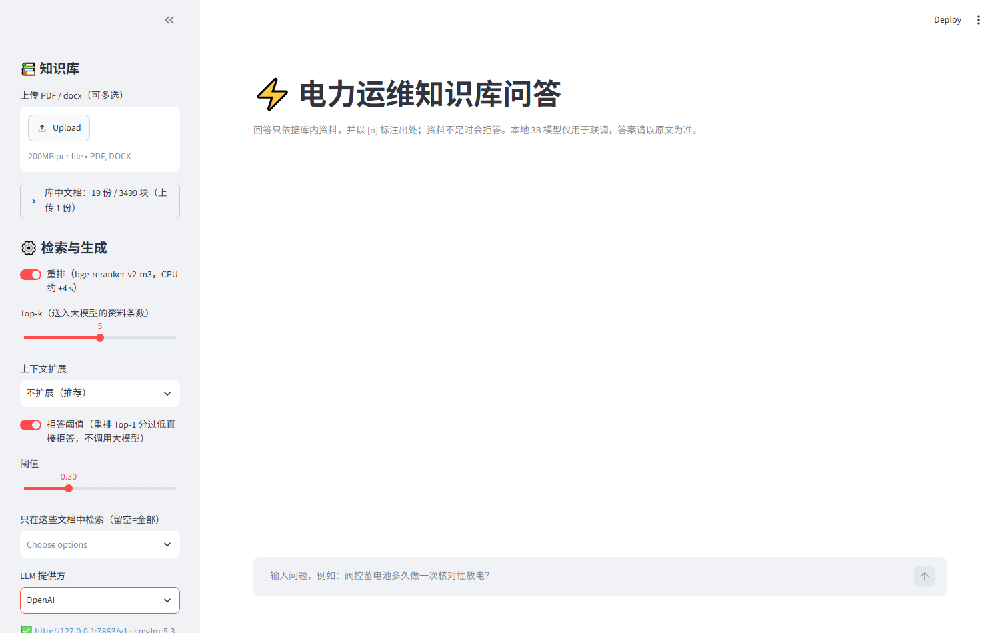
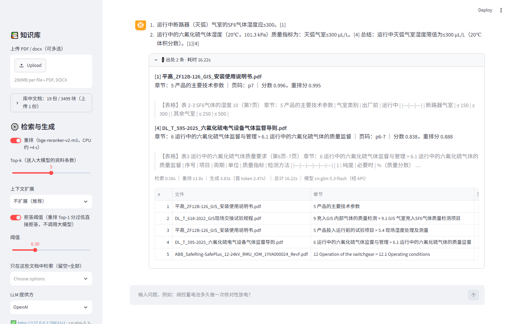
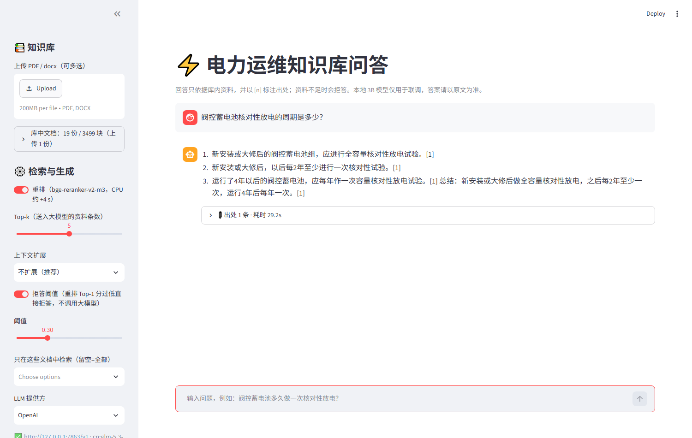

# PowerKB Windows 原生部署实录（按现场交付约束模拟：16GB 纯 CPU）

> 一套跑在 Mac 上的电力设备运维 RAG 知识库，迁到我自己的一台 Windows 10 机器上原生运行，按现场交付常见约束模拟部署：纯 CPU、不用 Docker、外网受限、安全策略拦截 `schtasks`/`wsl`，并保证检索与重排链路完整可用。这不是真实客户现场，而是按现场交付约束做的一次完整模拟；本文记录交付过程、踩坑与性能优化。

## 一、交付环境（模拟现场约束）

| 项 | 配置 |
|---|---|
| 操作系统 | Windows 10 22H2（build 19045） |
| 硬件 | 16 GB 内存 / 纯 CPU（无 GPU）/ 数据盘约 670 GB 可用 |
| 运行时 | Python 3.11.9（独立 venv），Node 无关 |
| 模型 | BAAI/bge-m3（嵌入）+ BAAI/bge-reranker-v2-m3（重排），共约 6.4 GB，本地缓存 |
| 知识库数据 | 19 份文档（DL/T 标准、南网文件、ABB/施耐德/西门子/平高手册，含扫描件），754 页 → 3499 检索块 + 175 张结构化表格，3543 条向量 |
| LLM | 不跑本地大模型，CPU 预算全部留给检索；本次部署实际使用 **glm-5.3-flash**，经本机 OpenAI 兼容中转服务接入（`http://127.0.0.1:7863/v1`，见截图）。注意：README 中的评测数据是用 **DeepSeek-V3** 测得的，与本次部署所用模型不同 |
| 网络约束 | 模拟受限外网：无外网直连保证：GitHub 需代理、pip/HuggingFace 全走国内镜像 |

## 二、交付步骤概览

1. **数据准备**：知识库原始数据在 Mac 上，打成 13 个分卷 + SHA256SUMS 清单跨机拷贝，落盘后逐片校验、合并、整包复校、解压。
2. **运行时**：winget 静默安装 Python 3.11 → 独立 venv → 清华镜像装依赖（torch 为 CPU 版）。
3. **模型获取**：hf-mirror 镜像下载 6.4 GB 模型（断点续传 + 过滤无关文件）。
4. **服务化**：FastAPI(8000) + Streamlit(8501) 双进程，bat 一键启动带健康检查。
5. **模型切换**：评测用 DeepSeek-V3，部署改接 glm-5.3-flash，因为走的是 OpenAI 兼容接口，只改配置（base_url / model / key），**代码零改动**。
6. **验收**：`/health` 全绿；两道真实业务题（SF6 湿度限值、阀控蓄电池放电周期）命中标准条文表格，引用编号、页码可溯源。

## 三、踩坑与解决（交付价值所在）

### 1. 跨网段与网络策略：默认代理是敌人也是朋友

- **现象**：`git clone` GitHub 报 502；环境默认代理（14170 端口）对 GitHub 不可用。
- **排查**：探测本机常见代理端口，发现 Clash 在 7890，`curl -x` 逐条测通后按命令粒度挂代理（`git -c http.proxy=…`），不污染全局配置。
- **同类**：pip 换清华源、HuggingFace 换 hf-mirror 后，又撞上 hf-mirror 不支持新版 Xet 传输协议（401）→ 设 `HF_HUB_DISABLE_XET=1` 走经典 HTTP 通道；镜像对 `.DS_Store` 等无关文件返回 403 中断整个下载 → 下载前按模式过滤。

### 2. 本机模型缓存落盘损坏：现象与根因隔着三层

- **现象**：模型显示下载完成，服务加载时报权重缺失。
- **排查**：逐层比对发现 **blobs 目录 2.27 GB 完好，但快照目录全是 0 字节空壳**——且该行为在本机可复现（断点续传后必现）。
- **解决**：写 `repair_hf.py`，按 HuggingFace 官方元数据把 blob 逐个对拷回快照路径，18 个文件全部修复；之后离线冒烟测试通过（模型加载 4.7s）。

### 3. PowerShell 5.1 兼容性：脚本在「正确写法」上死掉

- **现象**：安装脚本跑到一半无故中断，报 NativeCommandError。
- **根因**：PS 5.1 下 `$ErrorActionPreference='Stop'` 时，**原生命令向 stderr 写任何内容（包括进度条）都会抛异常**；配合 `2>$null` 或外层重定向必死。
- **解决**：定位 5 处关键原生命令段，临时降级错误策略，其他逻辑零改动；改造后全流程无人值守跑通。

### 4. 环境代理劫持本机服务调用：404 的真凶不是后端

- **现象**：前端报「后端 API 不可达 HTTP 404」，但后端 `/health` 直接 curl 秒回正常。
- **根因**：系统代理环境变量使前端 HTTP 客户端把 `127.0.0.1:8000` 的请求也发给代理，404 是**代理返回的**；另有大小写重复的代理变量（HTTP_PROXY/http_proxy）导致进程启动直接崩溃。
- **解决**：前端两处调用加 `trust_env=False`（本机 API 调用强制不走代理）；验证方式是模拟坏代理环境做 A/B 对照——旧代码必挂、补丁后 200。

### 5. 大文件传输与校验

- 13 个分卷逐个 SHA256 校验（浏览器自动重命名的 `(1)` 尾巴要处理），合并后整包二次校验再解压；
- 6.4 GB 模型下载利用断点续传，三次中断零浪费；
- 全程最长等待项是模型下载，通过镜像 + 过滤 + 续传把不可控的公网传输变成确定性步骤。

### 6. 安全策略限制下的降级方案

本机安全策略（模拟现场常见的程序管控）的程序黑名单拦掉了 `schtasks`（注册开机自启）与 `wsl`。不做硬闯：改为提供带健康检查的一键启动 bat，把「开机自启」留给用户在管理员权限下自行注册——交付以可用为准，不跟策略对抗。

## 四、性能优化：重排候选数调优

重排（cross-encoder）是 CPU 机器上的耗时大头。默认对 20 个候选逐条精筛，改为 10 个后实测如下（同一知识库、同一 LLM glm-5.3-flash、真实业务问题，单题观测）：

**冷态 vs 热态**：冷态指服务启动后的第一次请求，要承担模型权重首次进内存、PyTorch 算子初始化、磁盘页缓存未命中等一次性开销；热态指同一进程内已处理过请求（含相同/相近问题，嵌入与页缓存已就绪）后的请求。两种状态不能混着比，下面按同态对比。

| 配置 | 状态 | 总耗时 | 检索 | 重排 | 生成 | Top-1 重排分 |
|---|---|---|---|---|---|---|
| Top-20 | 冷态（首次请求成本） | 48.0 s | 4.5 s | 40.0 s | 3.4 s | 0.988 |
| Top-20 | 非冷态 | 36.1 s | 3.0 s | 29.7 s | 3.3 s | 0.995 |
| **Top-10** | 非冷态 | **29.8 s** | 2.8 s | **23.8 s** | 3.3 s | 0.997 |
| Top-20 | 热态 | [待实测] | [待实测] | [待实测] | [待实测] | [待实测] |
| Top-10 | 热态 | 16.2 s | 0.5 s | 11.8 s | 3.8 s | 0.996 |

- **同态对比**（非冷态）：Top-20 → Top-10 端到端 36.1 → 29.8 s（**-17%**），其中重排 29.7 → 23.8 s（-20%）；
- 冷态 48.0 s 是首次请求成本，单独列出，不作为优化前基线；热态 Top-10 的 16.2 s 需要与热态 Top-20 对比才能说明候选数的贡献，该行 [待实测]；
- **质量**：目前只有单题观测——这道题上 Top-1 重排分 0.995 → 0.997，最终只取前 5 条进 Prompt，未见退化；但单题的 Top-1 分数不能代表整体命中质量。**计划验证**：在 139 题评测集上分别以 `RERANK_TOP_N=10` 与 `20` 全量跑评测，对比正确率与 Hit@5，结果 [待实测]：

```bash
python evaluate.py --input eval_set_v3.jsonl --collection heading_v2 --provider siliconflow --prompt p2 --rules 3 --workers 4 --rerank-top-n 20 --tag rr20
python evaluate.py --input eval_set_v3.jsonl --collection heading_v2 --provider siliconflow --prompt p2 --rules 3 --workers 4 --rerank-top-n 10 --tag rr10
```

| 配置 | 正确率 | 块 Hit@5 |
|---|---|---|
| RERANK_TOP_N=20 | [待实测] | [待实测] |
| RERANK_TOP_N=10 | [待实测] | [待实测] |

- 定位方法：结构化日志按「检索 / 重排 / 生成」分段计时，先看清时间花在哪再动手。

### 下一步优化（计划）

调到 Top-10 后，重排仍占端到端耗时的 70–80%（23.8/29.8 ≈ 80%，热态 11.8/16.2 ≈ 73%），仍是首要瓶颈。候选方案：

- **ONNX 导出 + int8 量化**重排模型（CPU 推理通常有明显收益）；
- **换更小的重排模型**（参数量更小的 cross-encoder）；
- 每个方案都必须用上面的 139 题评测对比正确率与 Hit@5，质量不掉才采用——收益与质量影响均 [待实测]。

## 五、验收结果



- `/health`：模型加载成功，向量数 / BM25 / 文档数全部对账一致（3543 / 3543 / 19）；
- 真实提问 1：「运行中SF6设备灭弧气室的湿度限值是多少？」→ 命中平高 GIS 说明书湿度表格（出厂≤150/运行≤300）与 DL/T 595-2025 导则，双出处可溯源；

  

- 真实提问 2：「阀控蓄电池核对性放电的周期是多少？」→ 命中 DL/T 规程条文，回答带引用编号；

  

- 拒答与降级机制保留：重排分低于阈值直接拦截、LLM 失败自动降级为纯检索结果。

## 六、交付物清单

> 注：下表的 Windows 安装/启动脚本是本次部署的现场交付物，目前未纳入本仓库（仓库内只有本文档与截图）。截图为旧版前端（当时网关是借「OpenAI」档位接入的）；现在前端已有「自定义网关（OpenAI 兼容）」选项，见 [配置](../README.md#配置)。

| 交付物 | 说明 |
|---|---|
| `install_windows.ps1`（含 Windows 兼容补丁） | 一键安装：venv / 依赖 / 模型下载 / 数据校验合并 / 配置生成 |
| `repair_hf.py` | HuggingFace 缓存快照修复工具（针对本机可复现的 0 字节 bug） |
| `start_powerkb.bat` / `start_windows.ps1` | 一键启动（自动清端口 → 拉起双服务 → 健康检查 → 输出访问地址） |
| `WINDOWS_DEPLOY.md` | 面向现场人员的部署手册（含防火墙放行、开机自启） |
| `docs/DEPLOY_WINDOWS.md` | 本文档 |

## 七、30 秒讲述版（STAR）

- **S**：把跑在 Mac 的电力知识库迁到 Windows，按现场交付约束模拟部署（用自己的 Windows 机器模拟）：16GB 内存纯 CPU，不装 Docker，外网受限，安全策略拦截 schtasks/wsl。
- **T**：原生部署全链路（数据校验、模型下载、双服务化）并保证检索重排可用、耗时可接受。
- **A**：逐层消掉不确定项——代理分流与镜像替代、可复现的模型缓存损坏写了专用修复工具、PowerShell 5.1 兼容性补丁、代理劫持本机调用的根因定位；LLM 走 OpenAI 兼容接口，评测用 DeepSeek-V3、部署换 glm-5.3-flash 代码零改动；再按分段计时数据把重排候选 20→10。
- **R**：全程无人值守安装；同态对比端到端 36.1s → 29.8s（-17%，重排 29.7s → 23.8s），热态单题 16.2s；质量目前为单题观测未见退化，139 题全量对比评测已规划；两道真实业务题验收通过、引用可溯源。
