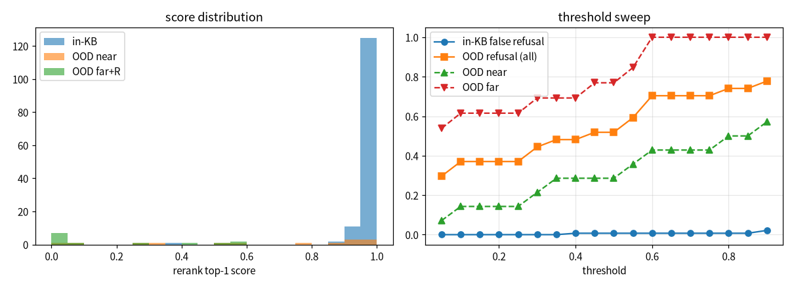

# 拒答阈值扫描（重排 Top-1 分）

库内 139 题（来自 v3set_sf_v3_p2），库外 27 题（R01–R05 + N01–N25；near=14，far/R=13）

| 阈值 | 库内误拒 | 库外拒答(全部) | 边界题 near | 完全库外 far+R |
|---|---|---|---|---|
| 0.05 | 0% | 30% | 7% | 54% |
| 0.1 | 0% | 37% | 14% | 62% |
| 0.15 | 0% | 37% | 14% | 62% |
| 0.2 | 0% | 37% | 14% | 62% |
| 0.25 | 0% | 37% | 14% | 62% |
| 0.3 | 0% | 44% | 21% | 69% |
| 0.35 | 0% | 48% | 29% | 69% |
| 0.4 | 1% | 48% | 29% | 69% |
| 0.45 | 1% | 52% | 29% | 77% |
| 0.5 | 1% | 52% | 29% | 77% |
| 0.55 | 1% | 59% | 36% | 85% |
| 0.6 | 1% | 70% | 43% | 100% |
| 0.65 | 1% | 70% | 43% | 100% |
| 0.7 | 1% | 70% | 43% | 100% |
| 0.75 | 1% | 70% | 43% | 100% |
| 0.8 | 1% | 74% | 50% | 100% |
| 0.85 | 1% | 74% | 50% | 100% |
| 0.9 | 2% | 78% | 57% | 100% |

库内 Top-1 分最低的 5 题：F40=0.395，O04=0.859，F20=0.897，O20=0.917，F06=0.920

库外题 Top-1 分：N24(ood)=0.002，R02(R)=0.003，N18(ood)=0.006，R04(R)=0.007，N06(near)=0.018，R05(R)=0.025，R03(R)=0.025，N17(ood)=0.044，N07(near)=0.059，R01(R)=0.065，N08(near)=0.277，N23(ood)=0.281，N12(near)=0.309，N21(ood)=0.448，N10(near)=0.524，N25(ood)=0.537，N16(ood)=0.551，N22(ood)=0.561，N11(near)=0.566，N02(near)=0.769，N15(near)=0.854，N01(near)=0.912，N04(near)=0.923，N09(near)=0.929，N14(near)=0.959，N05(near)=0.967，N03(near)=0.988

## 库外集（N01–N25）：LLM 自身拒答 vs 阈值拒答

- 阈值 关闭：阈值拒掉 0/22，LLM 自己拒答 22/22，合计正确拒答 22/22
- 阈值 0.1：阈值拒掉 5/22，LLM 自己拒答 22/22，合计正确拒答 22/22
- 阈值 0.2：阈值拒掉 5/22，LLM 自己拒答 22/22，合计正确拒答 22/22
- 阈值 0.3：阈值拒掉 7/22，LLM 自己拒答 22/22，合计正确拒答 22/22
- 阈值 0.4：阈值拒掉 8/22，LLM 自己拒答 22/22，合计正确拒答 22/22
- 阈值 0.5：阈值拒掉 9/22，LLM 自己拒答 22/22，合计正确拒答 22/22
- 阈值 0.6：阈值拒掉 14/22，LLM 自己拒答 22/22，合计正确拒答 22/22
- 阈值 0.7：阈值拒掉 14/22，LLM 自己拒答 22/22，合计正确拒答 22/22
- 阈值 0.8：阈值拒掉 15/22，LLM 自己拒答 22/22，合计正确拒答 22/22

LLM 没拒答的库外题：

## 选择与效果（库外 22 题，阈值 0.3）

| LLM | 自身拒答 | 阈值 0.3 拦截（不调 LLM） | 合计正确拒答 | 漏拒 |
|---|---|---|---|---|
| DeepSeek-V3 + p2 | 22/22 | 7/22 | 22/22 | — |
| 本地 qwen2.5:3b + p1 | 21/22 | 7/22 | 21/22 | N22（电容式电压互感器介损，Top-1=0.561，阈值拦不住） |

- 选 0.3：库内 139 题误拒 0%（库内最低分 F40=0.395，留了余量）
- 效果：两种模型的拒答率都没提高；阈值主要省掉约 1/3 库外问题的 LLM 调用（降低延迟和费用），也给更弱的模型或 prompt 多一层兜底
- 边界题（相近型号/参数）的 Top-1 分普遍 >0.8，阈值区分不了，只能靠 LLM 依据资料自行拒答
